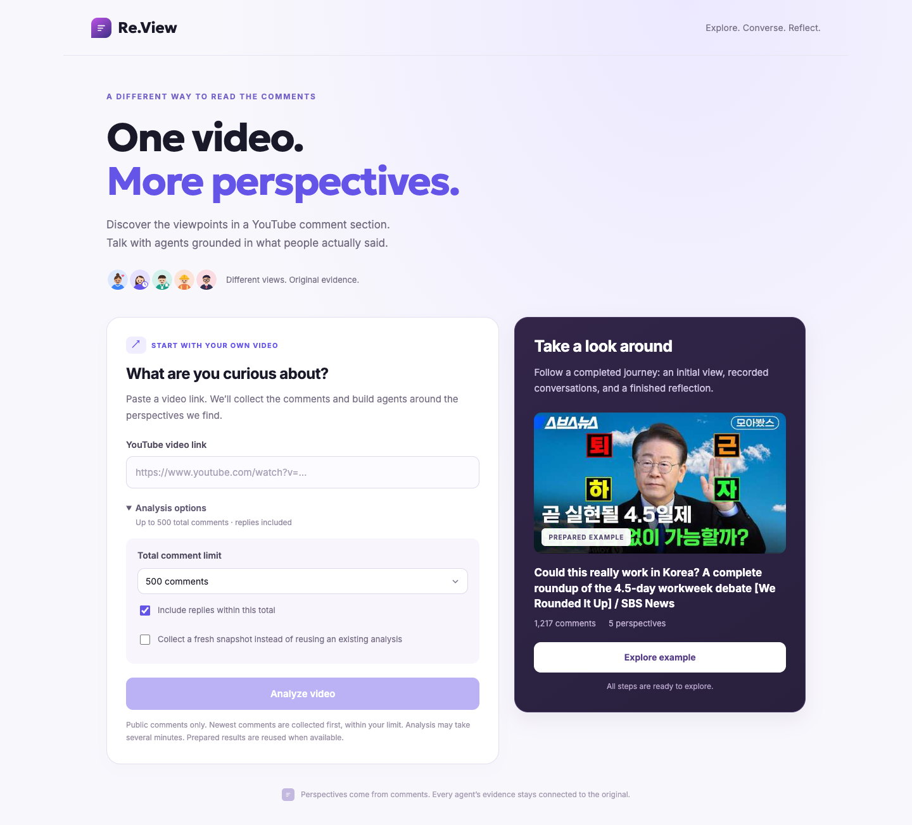
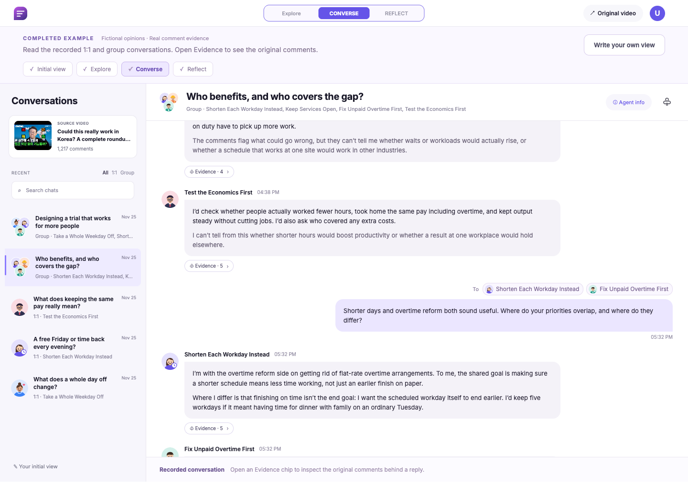
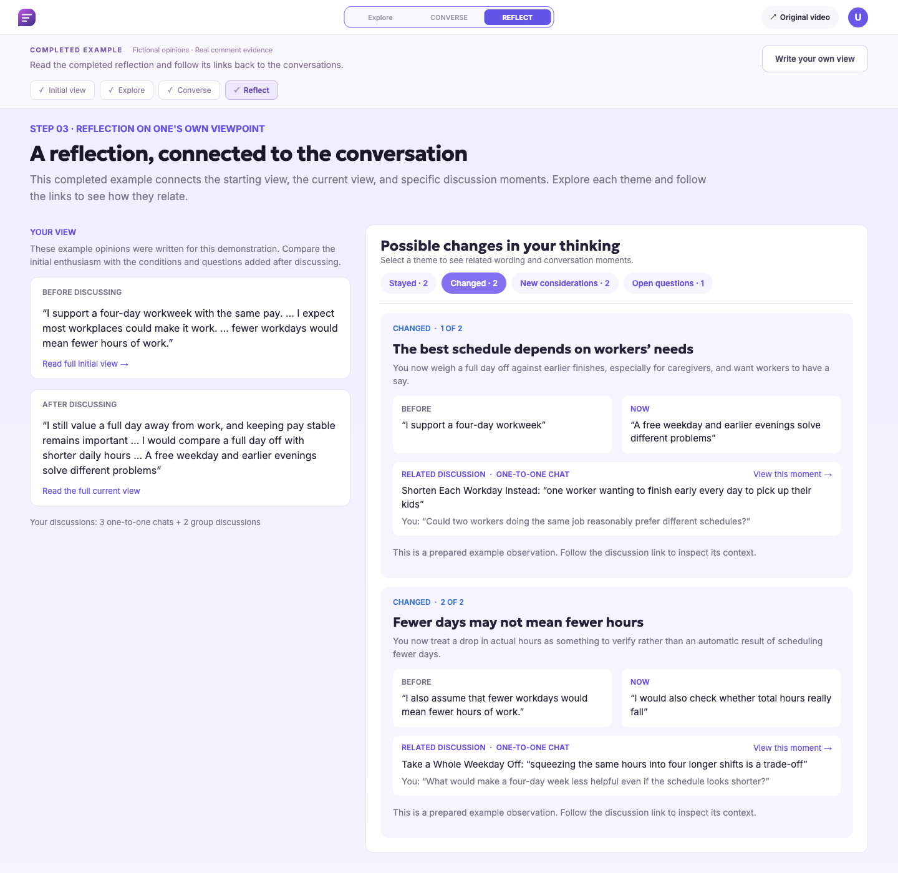

# YouTube Comment MAS

**One video. More perspectives.**

YouTube Comment MAS is a comment-grounded multi-agent system for exploring different viewpoints in a YouTube discussion. Its web interface, **Re.View**, helps you write down your starting opinion, explore perspectives found in public comments, talk with agents representing those perspectives, and reflect on what stayed the same or changed.

Instead of giving you only a single summary, the system keeps disagreements, conditions, and alternatives visible. Each agent has its own source comments, and its replies link back to the comments it used.

**[Try the live application](https://commentmas.vercel.app)** · [Run locally](#run-locally) · [How the agents work](#how-the-agents-work) · [Deployment](#deployment)



## Start with the completed example

If this is your first visit, choose **Explore example** on the [start screen](https://commentmas.vercel.app). You can move freely between **Initial view → Explore → Converse → Reflect** to see the entire experience without waiting for a new analysis.

The example follows a discussion about four-day and 4.5-day workweeks in Korea. It includes:

- A fictional starting opinion and a more conditional current opinion.
- Five perspectives derived from a real public YouTube comment section.
- Three one-to-one conversations and two group discussions: **54 messages in total**.
- Questions addressed to everyone and follow-up questions addressed to selected agents.
- Original comment evidence behind agent replies.
- A completed reflection with links to specific conversation moments.

The example opinions and user questions were written for this demonstration. Agent replies and reflection observations were generated using the public comment analysis and validated against the saved sources. The example contains no visitor's private conversation history.

The completed example is read-only. Browsing its prepared comparisons, conversations, evidence, and reflection makes **no new model requests**. Choose **Write your own view** to start a separate personal workspace.

## The experience

### 1. Choose a video

Paste a public YouTube video link into the start screen. The system collects comments, filters them for meaningful viewpoints, discovers perspective groups, and prepares an agent for each supported group.

Under **Analysis options**, you can choose:

| Option | Behavior |
| --- | --- |
| Total comment limit | 200, 500, 1,000, or 2,000 comments; the default is 500. |
| Include replies | Replies count toward the same total limit. |
| Collect a fresh snapshot | Collect comments again instead of reusing a matching prepared analysis. |

The interface shows progress as the analysis moves through collection, filtering, grouping, and presentation. A matching analysis for the same video, options, and model can be reused within your workspace.

New analyses can take several minutes. The duration depends on the number of comments, model latency, retries, and available caches. Opening the completed example does not require a new analysis.

### 2. Write your initial view

Before talking with the agents, write what you currently think about the topic. This becomes a reference point for perspective comparisons and later reflection. Updating your view affects new conversations; existing conversations retain the initial view they started with.

### 3. Explore the perspectives

Browse cards describing each group's position, reasoning, representative comments, and share of the analyzed comments and likes. Open a card to see:

- The group's stance and supporting arguments.
- Differences within the group and limits of its evidence.
- Source comments, including the original Korean text in the prepared example.
- Similarities, differences, and an additional consideration relative to your initial view.

Comments that do not confidently belong to a group remain available under **Other opinions**. They are not forced into an agent just to complete the overview.

### 4. Converse with one or several agents

Start a one-to-one conversation, or select two to five perspectives for a group conversation. Ask an opening question, let the agents respond, and use follow-up questions to explore trade-offs.

In a group conversation, you can:

- Address everyone or select particular agents.
- See the selected agents' **names and icons above your sent question**.
- Pause or resume agent-to-agent discussion.
- Inspect evidence for individual replies and save useful comments.
- Reopen saved conversations and retry failed replies.

Recipient selections are stored with the question, so the label survives a reload. A retry keeps the original recipients and preserves successful replies.

Automatic discussion is bounded: one resume action allows at most six additional agent turns. Pausing lets an answer already in progress finish, then prevents the next turn from starting.



### 5. Reflect on your view

Write your current view after the conversations. The reflection compares it with your starting view and offers tentative observations in four categories:

| Category | What it helps you notice |
| --- | --- |
| **Stayed** | A belief or priority you kept. |
| **Changed** | A belief you revised or made more conditional. |
| **New considerations** | Something you are now weighing that was absent from your initial view. |
| **Open questions** | Something that remains unresolved. |

Where a relevant moment is available, **View this moment** takes you back to the related agent message. You can review the interpretation, edit it, provide feedback, and save your reflection.

Reflection is an aid to examining your own thinking. It does not score whether you became more correct or whether an agent successfully persuaded you.



## How the agents work

### The analysis pipeline

```text
Public YouTube video link
        ↓
Collect comments and replies
        ↓
Filter for meaningful viewpoints
        ↓
Discover perspectives and assign comments
        ↓
Build up to five agents with separate evidence pools
        ↓
Prepare perspective cards and English display data
        ↓
Explore → Converse → Reflect
```

**Collection.** The collector uses the official YouTube Data API v3. It retrieves newest top-level comments first and, when enabled, follows their replies within the total limit. This is a snapshot of accessible public comments, not a random sample of all viewers.

**Filtering.** Comments are retained when they express a relevant position, proposal, concern, experience, reason, or meaningful question. Clear spam, empty reactions, and unrelated content can be excluded. Ambiguous or low-confidence cases are kept separately for review. Proposed model exclusions receive a second review. Shortness, sarcasm, profanity, low likes, or being a minority opinion are not by themselves reasons to exclude a comment.

**Grouping.** The model discovers groups based on a position **and its reasons**, rather than topic words or positive/negative sentiment alone. It aims for four or five useful groups when supported, with a hard limit of five. A smaller or more homogeneous discussion may produce fewer agents. The system does not invent missing perspectives to fill a quota.

Each retained comment has at most one primary group, with optional secondary perspectives recorded separately. Uncertain or weakly fitting comments remain **Other opinions**. There is no rule that automatically discards a viewpoint because it accounts for less than 5% of the comments.

**Agent construction.** Each supported group becomes an agent with its stance, arguments, internal differences, limitations, and full set of owned source comments. Assembling this bundle is a local operation. Display copy, translations, and topic-specific symbolic emojis are prepared separately with the model.

### Evidence and conversation memory

For a new question, an agent searches only its own comments using local word and character-bigram retrieval, with Korean-aware tokenization. The model receives a limited set of relevant comments, supplemented by representative evidence when appropriate. Search queries can be translated into the detected source languages without changing the user's original question.

Replies distinguish between:

- **Comment-grounded statements**, which must reference retrieved comments belonging to that agent.
- **Reasoning**, which is identified as interpretation rather than a source quotation.
- **Uncertainty**, where the available comments cannot answer the question.

The server validates source IDs and attaches the original stored comments. Agents may read each other's messages as conversational context, but they cannot cite another group's private evidence pool as their own.

Conversation state includes the initial view, participants, messages, recipients, evidence, and pause state. The full transcript is stored, while model requests use recent messages and a small number of relevant earlier messages. Agents represent comment-group perspectives; they do not impersonate particular commenters or invent a human biography.

### The prepared example's five perspectives

These labels belong to the bundled workweek discussion. A different video can produce different groups, labels, and icons.

| Agent | Perspective |
| --- | --- |
| `g1` | Take a Whole Weekday Off |
| `g2` | Shorten Each Workday Instead |
| `g3` | Fix Unpaid Overtime First |
| `g4` | Keep Services Open |
| `g5` | Test the Economics First |

The original analysis collected 1,217 comments, retained 1,150, assigned 863 to the five agents, and preserved 287 as other opinions. These are counts for that collected snapshot, not all comments currently visible on YouTube.

## Run locally

### Prerequisites

- **Python 3.10 or newer**; Python 3.13 is used by the deployment container.
- **Node.js 22.12 or newer** and npm.
- A model API key for live interactions: OpenAI, or the supported OpenRouter alternative.
- A YouTube Data API v3 key to analyze new videos.

The local Python application and analysis pipeline use the standard library. `requirements.txt` adds the Firebase Admin SDK for the cloud storage and identity backend. Firebase configuration is not needed for local mode.

### 1. Clone and prepare the environment

```bash
git clone https://github.com/angelaoh0619/Youtube-Comment-MAS.git
cd Youtube-Comment-MAS

python3 -m venv .venv
source .venv/bin/activate
python -m pip install -r requirements.txt

cp .env.example .env
```

On Windows, activate the virtual environment with `.venv\Scripts\activate`.

Edit `.env` and replace the placeholders with your own values:

```dotenv
YOUTUBE_API_KEY=your_youtube_data_api_key
OPENAI_API_KEY=your_openai_api_key
LLM_PROVIDER=openai
OPENAI_MODEL=gpt-6.2-sol
OPENAI_REASONING_EFFORT=medium
```

The model above is the repository's configured default. Set `OPENAI_MODEL` to a model available to your account that supports the structured output used by this application. Reasoning effort is configurable as `low`, `medium`, or `high` for supported reasoning models.

For OpenRouter instead, select it explicitly and use a model that supports structured outputs:

```dotenv
LLM_PROVIDER=openrouter
OPENROUTER_API_KEY=your_openrouter_api_key
OPENROUTER_MODEL=openai/gpt-4.1-mini
```

An explicit provider selection does not silently fall back to another provider. Environment variables take precedence over `.env`.

Keep real credentials in `.env`, which is ignored by Git. Model and YouTube keys belong on the Python server, never in `VITE_*` variables or frontend source code.

### 2. Install the bundled example

```bash
python scripts/setup_example.py
```

This copies the curated public analysis into the default runtime location:

```text
data/processed/BAHKmi4F1L8_20261026-144540/
```

Setup validates the prepared conversations and evidence without calling a model. Re-running it is safe when the bundled files match. If different analysis files already exist, it stops rather than overwriting your work. Use `--data PATH` to install into another folder, and pass the same path to `web_server.py --data PATH`.

The server initializes a model client at startup, so configure a model key even if you initially plan only to browse the example. Browsing the completed example itself uses prepared content. A YouTube key is needed when you submit a new video, not to open the existing example.

### 3. Build the frontend and start the server

```bash
cd frontend
npm ci
npm run build
cd ..

python web_server.py --local
```

Open **http://127.0.0.1:8000**. The Python server serves both the built frontend and `/api` routes.

`--local` explicitly uses local storage and ignores Firebase backend settings. The frontend also bypasses Firebase sign-in on localhost. Local mode is a development workspace on your machine.

To use a different port:

```bash
python web_server.py --local --port 8011
```

Rebuild the frontend after changing its source when using the Python server's built-in static serving.

### Frontend development

Keep the Python server running on port 8000. In a second terminal:

```bash
cd frontend
npm run dev
```

Open **http://127.0.0.1:5173**. Vite reloads UI changes and proxies `/api` to the Python server on port 8000.

## Project structure

```text
.
├── README.md
├── collect_comments.py          # YouTube URL parsing and official API collection
├── filter_comments.py           # Meaningful-opinion filtering and review
├── group_comments.py            # Perspective discovery, assignment, and summaries
├── perspective_agents.py        # Agent bundles, retrieval, replies, and sessions
├── analysis_pipeline.py         # Video library and resumable local analysis jobs
├── cloud_analyses.py            # Durable analysis artifacts and cloud job leases
├── web_data.py                  # Display data, translations, and view comparisons
├── web_server.py                # HTTP API, conversations, discussion, and reflection
├── recorded_example.py          # Immutable walkthrough and source validation
├── firebase_backend.py          # Verified identities and user-scoped Firestore stores
├── llm_client.py                # OpenAI and OpenRouter structured-output clients
├── frontend/
│   ├── src/                     # React + TypeScript application
│   ├── public/assets/           # Local SVG assets
│   └── tests/                   # Playwright browser tests
├── examples/
│   ├── four-day-week.json       # Authored walkthrough snapshot
│   └── sample-analysis/         # Portable public analysis and matching walkthrough
├── scripts/
│   ├── setup_example.py         # Install the bundled sample without paid API calls
│   ├── prepare_example_journey.py
│   ├── prepare_deploy.py
│   ├── deploy_backend.py
│   └── deploy_frontend.py
├── tests/                       # Python unit and API tests
├── docs/images/                 # Screenshots of the fictional completed example
├── Dockerfile
└── requirements.txt
```

### Runtime files

New video analyses are stored under `data/analyses/<analysis_id>/`. Each analysis separates its source and results by stage:

| Folder | Contents |
| --- | --- |
| `00_source/` | Collected comments and detected source-language context. |
| `01_filter/` | Retained, excluded, and review comments; filter decisions and caches. |
| `02_group/` | Groups, assignments, summaries, and other opinions. |
| `03_agents/` | Agent bundle and individual profiles. |
| `04_web/` | Display catalog, translations, comparisons, conversations, and reflections. |

The CLI chat tool stores its sessions under `03_agents/sessions/`. Browser preferences and some local-mode user state use browser storage; deployed user records are saved through the authenticated backend.

The repository excludes runtime data, personal conversations, local environment files, build outputs, deployment credentials, and debug logs. `examples/sample-analysis/` contains only a curated public snapshot and the explicitly fictional completed walkthrough. Its metadata paths are portable; raw collection files and model batch caches are not included.

## Command-line tools

The web application runs the pipeline for you. The CLI tools are also useful for inspecting individual stages.

### Collect and analyze your own data

```bash
# The command prints the actual timestamped JSON path it creates.
python collect_comments.py "https://www.youtube.com/watch?v=VIDEO_ID" --max 500

# Replace the following paths with the files printed by the preceding steps.
python filter_comments.py data/VIDEO_ID_TIMESTAMP.json
python group_comments.py data/processed/VIDEO_ID_TIMESTAMP/01_filter/filtered.json
python build_agents.py data/processed/VIDEO_ID_TIMESTAMP/02_group/groups.json
python prepare_web.py --data data/processed/VIDEO_ID_TIMESTAMP
```

The CLI filter and grouping tools expose additional options through `--help`, including provider, model, output folder, and review thresholds. Filtering with `--offline` only exercises the conservative local rules and output format; it does not produce a full semantic analysis.

The bundled sample is a prepared result for exploration. To rerun collection and all analysis stages, collect a fresh source snapshot with your own API keys.

### Talk with prepared agents

After installing the bundled example:

```bash
python chat_agents.py \
  --registry data/processed/BAHKmi4F1L8_20261026-144540/03_agents/agents.json \
  --agents g1 g5 \
  --initial-opinion "I support shorter hours, but want to understand the trade-offs."
```

Useful interactive commands:

| Command | Action |
| --- | --- |
| `/to g1,g5` | Choose which participants answer your next question. |
| `/sources` | Inspect evidence for the latest agent reply. |
| `/sources m0003` | Inspect evidence for a particular reply. |
| `/history` | Show the saved transcript. |
| `/debate 1` | Request a bounded round of agent-to-agent discussion. |
| `/retry m0001` | Retry missing replies to a question. |
| `/exit` | Leave the conversation; its state remains saved. |

The tool prints the session file path. Use `--session PATH` to resume it later. Existing room participants remain fixed; create another room for a different set of agents.

### Rebuild the fictional walkthrough

Normal setup and browsing do not need this step. To regenerate the authored example with live agents:

```bash
python scripts/prepare_example_journey.py
```

This uses the configured model API and incurs usage. It writes `examples/four-day-week.json` and keeps its generation workspace under the ignored `.deploy/` directory. It uses the scripted fictional opinions and questions, not personal conversation history.

If `setup_example.py` installed `04_web/example_journey.json`, that installed snapshot takes precedence. To use the newly generated walkthrough in that runtime folder, copy the generated file there:

```bash
cp examples/four-day-week.json \
  data/processed/BAHKmi4F1L8_20261026-144540/04_web/example_journey.json
```

## Tests

Install the bundled example before running the full Python suite, because the recorded-example tests validate against its real source analysis.

```bash
python scripts/setup_example.py
python -m unittest discover -s tests -v
```

For the frontend build and browser tests:

```bash
cd frontend
npm ci
npm run build
npm run test:e2e
```

The Playwright configuration uses the **Chrome** channel. Install Google Chrome first, or install that channel with `npx playwright install chrome`. The browser suite starts Vite and mocks the API, so it does not require a live model key or paid requests.

Coverage includes comment preservation, source ownership, grouping partitions, structured response validation, cache reuse, selected recipients, bounded discussion, partial-failure retries, account isolation, durable analysis recovery, immutable example browsing, and reflection links. Automated checks validate structure and behavior; they do not measure the semantic accuracy of every generated interpretation.

## Deployment

The live application uses the following components:

| Component | Role |
| --- | --- |
| **Vercel** | Hosts the built React application and forwards `/api` to Cloud Run. |
| **Google Cloud Run** | Runs the Python API and analysis workers. |
| **Firebase Authentication** | Creates an anonymous browser identity without a registration screen. |
| **Cloud Firestore** | Persists user-scoped analyses, conversations, saved evidence, and reflections. |
| **Google Secret Manager** | Supplies server-only model and YouTube API keys. |

The backend verifies Firebase identity tokens before selecting a user's store. New video analyses are scoped under `users/<uid>/analyses/<analysis_id>`. The shared recorded walkthrough is served through a separate immutable scope. Anonymous browser sessions are not a cross-device account: clearing site data or using a different browser can change which workspace you can access.

Cloud Run's local disk is a working cache. Analysis artifacts and completed batch checkpoints are persisted to Firestore, with job leases to limit duplicate execution. If a worker stops, an interrupted job can be resumed from saved work. Jobs are not automatically restarted with new paid requests after a server restart. In-memory conversation jobs may still need a retry after an instance is replaced.

The included deployment scripts describe the existing demo installation. **Before deploying a fork, change the project, region, service, Vercel scope, Firebase configuration, API routing, and allowed origin to your own resources.** The repository's current `frontend/vercel.json` points to the existing demo API.

A deployment sequence is:

1. Create your Google Cloud/Firebase project, connect billing, and authenticate the Google Cloud CLI and Vercel CLI.
2. Update the deployment constants in `scripts/deploy_backend.py`, the default Vercel scope in `scripts/deploy_frontend.py`, and `.firebaserc` for your project.
3. Initialize Firebase using `python scripts/setup_firebase.py --project YOUR_PROJECT --name YOUR_NAME --app-name YOUR_APP`. The helper writes your local frontend Firebase configuration. Create the default Cloud Firestore database in Native mode in your Firebase/Google Cloud console, choosing the location appropriate for your project.
4. Configure server keys in `.env` and set `ALLOWED_ORIGINS` to your frontend's exact HTTPS origin.
5. Install the bundled example, then run `python scripts/deploy_backend.py`. It stages the public example, configures anonymous auth and server access, stores keys in Secret Manager, deploys Cloud Run, and writes the API rewrite.
6. Supply the four `VITE_FIREBASE_*` values from `frontend/.env.example` in `frontend/.env.production.local`, then deploy with `python scripts/deploy_frontend.py --scope YOUR_VERCEL_SCOPE`. When using Vercel's Git integration, set the project root to `frontend` and add those variables to its build environment.
7. Confirm that the frontend origin matches the backend's `ALLOWED_ORIGINS`, then test a fresh browser session, a new analysis, and a saved conversation.

The Firebase web configuration identifies a public client application. Model API keys, YouTube keys, service-account credentials, and administrative access stay on the server. The Cloud Run container expects `deploy-data/`, which `scripts/prepare_deploy.py` generates from an installed public example; it is intentionally excluded from Git.

## Costs, data handling, and limitations

- **Paid operations:** New video analysis, live questions, agent discussion, new perspective comparisons, reflection generation, and uncached translations can call the selected model provider. YouTube collection uses your API quota. Hosting and storage can also incur costs. Prepared walkthrough browsing uses no new model calls.
- **Data sent to the model:** Depending on the operation, the system sends comment text, parent context, video/topic text, your initial/current view, and relevant conversation excerpts. Comment authors and like counts are excluded from the filtering, grouping, and agent-reply model inputs. OpenAI requests set `store=false`.
- **Sampling:** The newest-first collection and reply limit are not representative sampling. Displayed percentages refer to the retained analyzed comments, not all viewers or the public at large. Likes indicate engagement within the snapshot, not the truth of a statement.
- **Interpretation:** Filtering, grouping, translation, answers, comparisons, and reflections can be mistaken. Source-ID validation confirms where evidence came from; it cannot prove that a model interpreted the evidence correctly.
- **Scope:** Agents discuss the collected comments. They do not independently verify current laws, statistics, research, or claims made by commenters. Inspect the linked originals when assessing an answer.
- **Language:** The prepared example uses Korean comments with English presentation. The new-video pipeline detects source languages for retrieval, while some filtering and grouping prompts are written for Korean analysis. Coverage across languages should be evaluated rather than assumed.
- **Availability:** Deleted/private videos, disabled comments, quota limits, model access, and provider failures can prevent an analysis. An interrupted job can preserve completed work without guaranteeing that every stage finished.

## Troubleshooting

| Problem | What to check |
| --- | --- |
| Missing example files or catalog | Run `python scripts/setup_example.py` from a fresh clone. Use the same `--data PATH` for setup and the server when choosing a custom folder. |
| Setup reports existing files differ | Preserve your current work and choose another `--data` directory. Setup intentionally does not overwrite an existing analysis. |
| Missing model key or a provider error | Check `.env`, `LLM_PROVIDER`, model access, and account quota. The selected provider does not automatically switch to another one. |
| New video fails before collection | Check the URL, public availability, comment settings, YouTube Data API v3 enablement, and `YOUTUBE_API_KEY`. |
| UI changes do not appear on port 8000 | Run `npm run build` in `frontend`, or use the Vite development server. |
| Vite cannot reach the API | Start `python web_server.py --local` on port 8000; that is the configured development proxy target. |
| Deployed session cannot open | Check Firebase anonymous sign-in, the four frontend Firebase variables, and the backend's Firebase project. |
| One agent fails to answer | Retry the missing response; successful answers and the original recipient selection are preserved. |
| Analysis was interrupted | Use **Resume analysis** to reuse saved sources and validated stage caches. |

For a quick introduction, open the [live example](https://commentmas.vercel.app), read a group conversation, follow an **Evidence** link, and then use **View this moment** in the reflection to see how the pieces connect.
